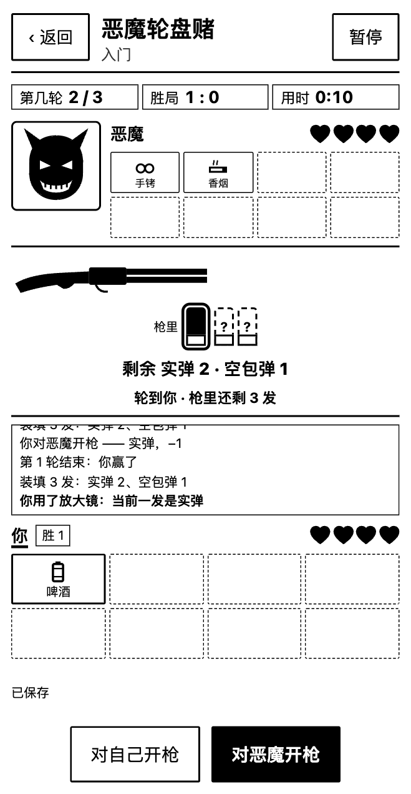
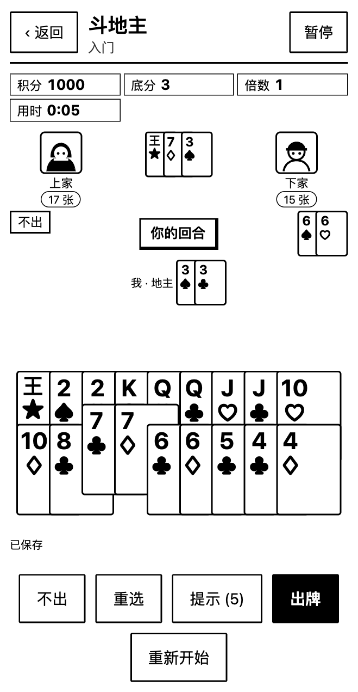
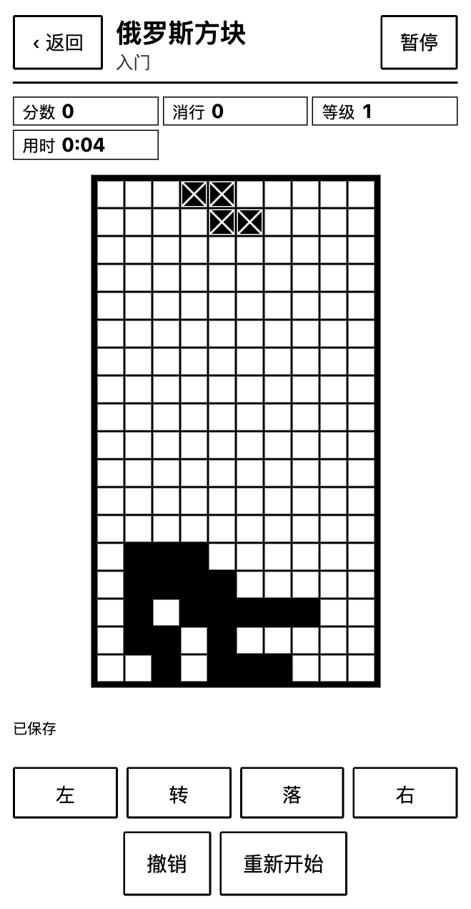
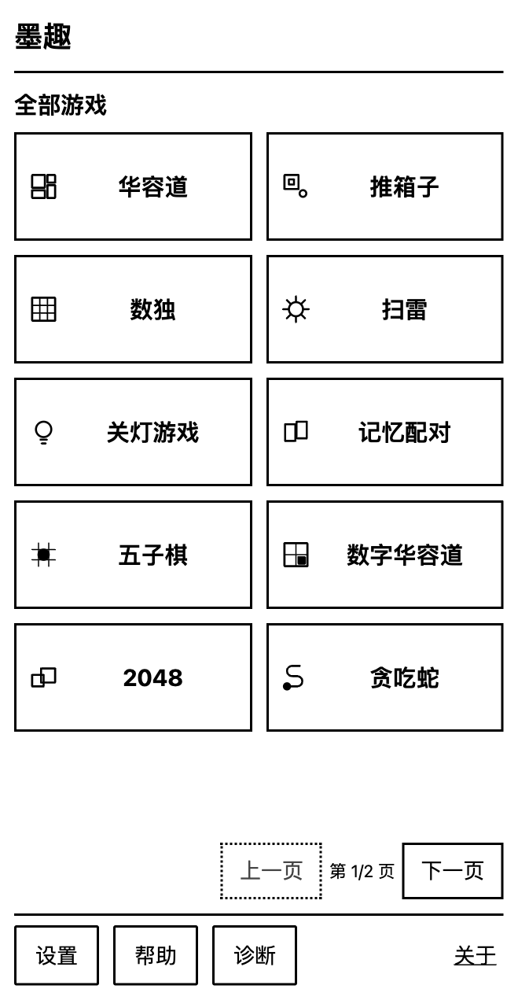
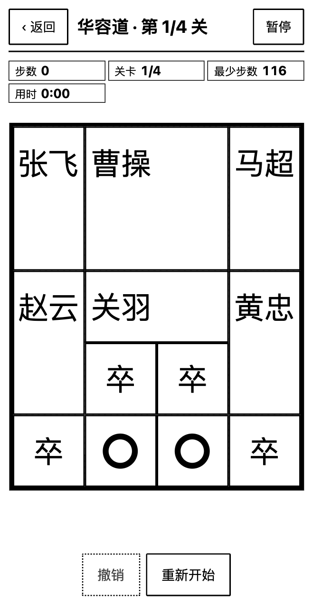
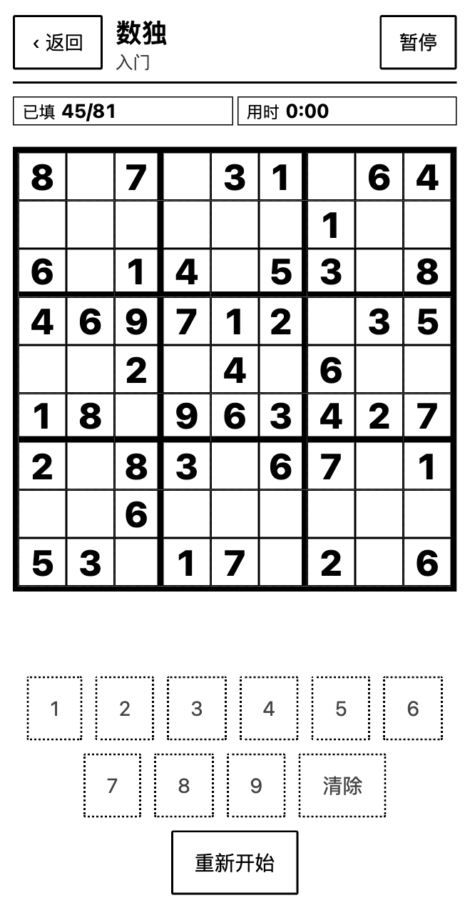
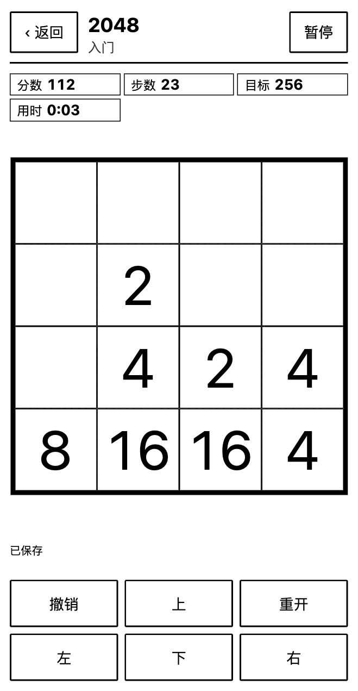
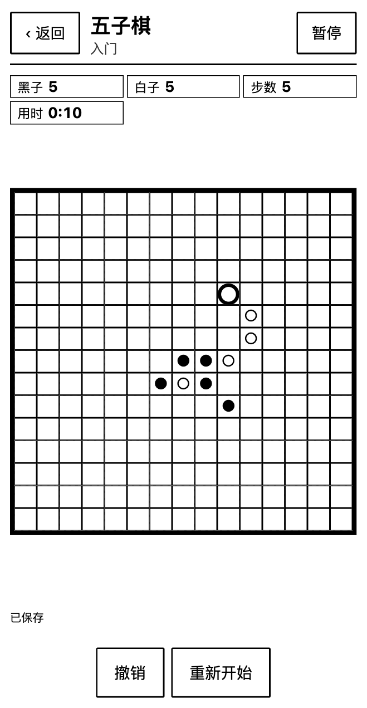
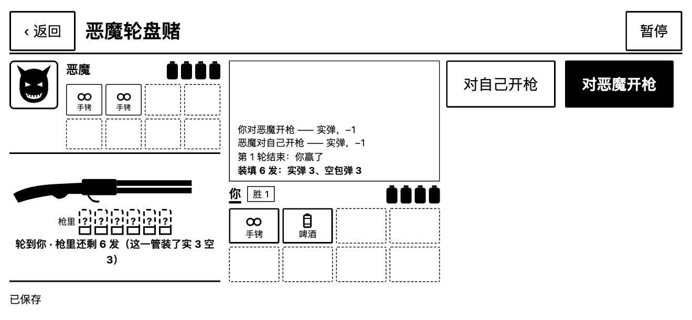

<div align="center">


# 墨趣 · Moqu

**为墨水屏而生的离线游戏合集**

*An offline game collection designed for e-ink screens*

<p>
  
  
  
  
</p>

> **[本分支](../../tree/kindle)是 Kindle 专属版。**
>
> 交付物只有一个：`apps/kindle/dist` —— 纯 ES5、无模块脚本、无 CSS 变量 / grid 的静态文件，
> 部署到 Cloudflare Pages（构建命令 `npm run build:kindle`，步骤见 [docs/kindle.md](docs/kindle.md)）。
> 玩法与逻辑和 Web / Android 共用同一套引擎（packages/core + packages/games），
> 因此仓库里保留着那两个形态的源码与说明，**只作为共享引擎的上下文与契约测试**；
> 要装 Web PWA 或 APK，请到[主分支](https://github.com/yuban10703/Moqu-gamebox/tree/main)。

### ▶ [在线试玩 · moqu.2333.world](https://moqu.2333.world/)

部署的是**本分支的 Kindle 构建**：阅读器与桌面浏览器打开即玩。
（Web 版的「添加到主屏幕」安装是主分支的形态 —— 本分支产物没有 Service Worker。）

[游戏一览](#游戏一览) · [装到墨水屏](#装到墨水屏阅读器) · [自己构建](#自己构建)

</div>

---

20 款游戏，中文 / 英文，**完全离线、不要任何权限**。

不是把手机游戏搬到墨水屏上，而是围绕墨水屏从头设计：纯黑白、没有动画、点按优先、分页代替滚动、断电不丢进度。

## 游戏一览

难度从 *入门* 起：多数玩法是 *入门 / 熟练 / 挑战* 三档；空当接龙分「抽 1 张 / 抽 3 张」，井字棋另有「双人同屏」。

**益智解谜**

- **推箱子** —— 自制关卡，求解器校验过，保证可解
- **华容道** —— 把曹操挪到出口，并显示最少步数
- **数独** —— 9×9，先点格子再点数字键
- **数织** —— 5×5 / 10×10 共 16 道题，行列外侧的数字就是线索
- **扫雷** —— 点格子翻开，可切换标记模式
- **关灯游戏** —— 5×5 / 6×6，一次翻转十字范围内的灯
- **数字华容道** —— 3×3 / 4×4 / 5×5，直接点数字块滑动
- **记忆配对** —— 翻开两张牌，符号相同即配对
- **2048** —— 滑动或方向键，同一次移动里每块只合并一次
- **消消乐** —— 交换相邻两格凑三连，凑不成的交换不扣步数

**棋牌对战**

- **五子棋** —— 你执黑先手，对战三档电脑
- **井字棋** —— 三档电脑（应手分两拍亮出）+ 双人同屏
- **空当接龙** —— 抽 1 张 / 抽 3 张两档，每步都能撤销
- **斗地主** —— 标准三人局，叫分制，炸弹和春天翻倍，积分跨局累计
- **恶魔轮盘赌** —— 实弹与空包弹的心理博弈，8 种道具、共 3 轮；可对战三档恶魔，也可**双人同屏**，还有**无尽模式**记最高纪录
- **中国象棋** —— 你执红先行，标准规则（马腿 / 象眼 / 炮架 / 将帅照面都算数），对战三档电脑
- **国际象棋** —— 你执白先行，标准规则（易位 / 吃过路兵 / 升变自动变后），对战三档电脑
- **黑白棋** —— 你执黑先手，落子夹住的白子全翻黑；子多者胜，对战三档电脑

**动作街机**

- **贪吃蛇** —— 三档分别是可穿墙、实心墙、障碍加长两节
- **俄罗斯方块** —— 平铺的「左 · 转 · 落 · 右」按键

<table>
  <tr>
    <td align="center" width="25%"><br><sub><b>恶魔轮盘赌</b> · 第 2 轮，8 种道具</sub></td>
    <td align="center" width="25%"><br><sub><b>斗地主</b> · 叫 3 分当地主</sub></td>
    <td align="center" width="25%"><br><sub><b>俄罗斯方块</b> · 平铺方向键</sub></td>
    <td align="center" width="25%"><br><sub><b>游戏库</b> · 分页，不滚动</sub></td>
  </tr>
  <tr>
    <td align="center"><br><sub><b>华容道</b> · 显示最少步数</sub></td>
    <td align="center"><br><sub><b>数独</b> · 点格子 + 数字键</sub></td>
    <td align="center"><br><sub><b>2048</b> · 滑动或方向键</sub></td>
    <td align="center"><br><sub><b>五子棋</b> · 对战三档电脑</sub></td>
  </tr>
</table>

<p align="center">
  <br>
  <sub>横屏自动换成左右两栏。</sub>
</p>

## 装到墨水屏阅读器

- **Kindle（本分支的交付形态）**：先把产物部署到任意静态托管（Cloudflare Pages 的填法见
  [docs/kindle.md](docs/kindle.md) 的「部署到 Cloudflare Pages」一节），再用 Kindle 自带浏览器打开网址即可。
  产物要求极低：纯 ES5、无模块脚本、无 CSS 变量 / grid。
  设备能力**没有在本仓库实测过**（手头只有 BOOX），所以内置了一个不依赖任何外部文件的
  设备自检页 [`check.html`](check.html) —— 先在 Kindle 上打开它，就能看清这台设备到底支持什么。
  细节、已知限制与自检方法见 [docs/kindle.md](docs/kindle.md)。
- **BOOX 等 Android 阅读器 / Web PWA（主分支的形态）**：「添加到主屏幕」当离线应用用，或从
  [Releases](https://github.com/yuban10703/Moqu-gamebox/releases) 下载 `moqu-<版本>.apk`
  （Android 6.0 以上都行；APK 由**主分支**的 CI 发布，本分支不打包）。见 [docs/android.md](docs/android.md)。

## 自己构建

```bash
npm ci
npm run build:kindle # **本分支的产物**（ES5，含语法守卫与体积报告）→ apps/kindle/dist/
npm run check        # 门禁：类型检查 + 全部测试（含 web 侧契约）+ i18n + 文档/游戏完整性
npm run serve:kindle # 局域网服务，打印 Kindle 能用的地址
npm run verify       # 提交前：类型检查 + 全部测试 + 五套真浏览器巡检
```

Web 与 Android 的构建（`dev:web` / `build:web` / `build:apk` 等）是**共享引擎的开发与契约工具**，
保留在本仓库，但不是这条分支的交付物（Web 产物/发布走主分支）。
项目全貌与真机流程见 [docs/handover.md](docs/handover.md)，架构见 [docs/architecture.md](docs/architecture.md)，
Kindle 版见 [docs/kindle.md](docs/kindle.md)。

## 关于 AI

本项目由 AI 协作开发：主体使用 **DeepSeek Harness（DSH）**，协作者部分使用 **Claude**。
人负责需求、决策与验收。

所有产出都过自动化门禁（`npm run verify`：类型检查 + 全部单元测试 + 五套真浏览器巡检），
涉及设备行为的部分在两台墨水屏阅读器上实测复核。

## 许可证与内容来源

关卡内容为自制（房间模板 + 固定种子反向生成 + 求解器校验），不包含第三方题库。
依赖与 SDK 的来源和使用条件见 [docs/A03-dependencies.md](docs/A03-dependencies.md)。

<div align="center">
<br>
<sub>墨趣 · 在墨水屏上，慢慢玩。</sub>
</div>

<div align="center">

[](https://github.com/deepseek-ai/deepseek-harness)

</div>
